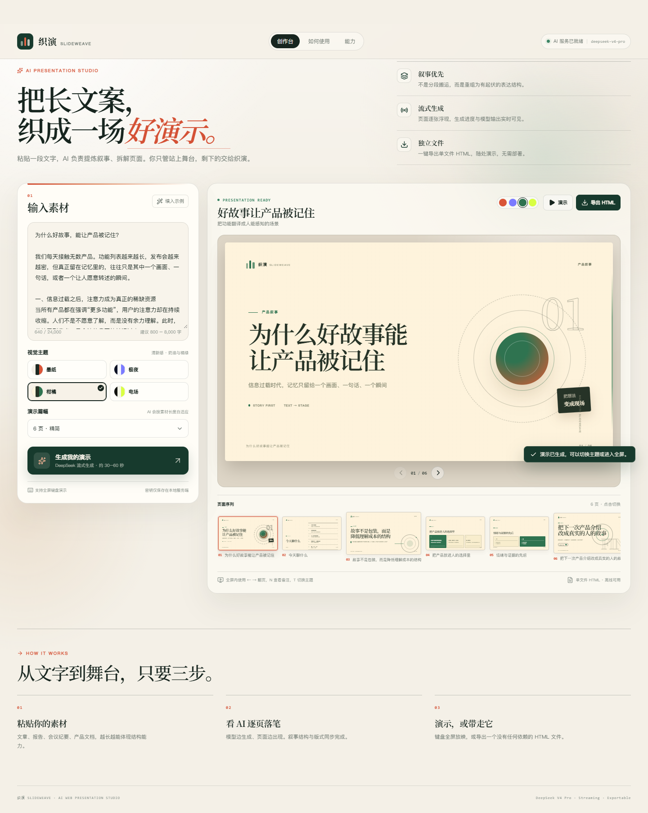

# 织演 Slideweave · AI 网页 PPT 生成器

**在线演示**：https://slideweave-d5g8tsj23944c6b5d-1531030749.tcloudbaseapp.com
（粘贴一段文字 → 生成网页版 PPT → 全屏演示 / 导出单文件 HTML）



> 仓库内的 `docs/preview.png` 是实际运行界面的截图。生成过程依赖大模型 API，需要自行配置
> `DEEPSEEK_API_KEY`（或任意 OpenAI 兼容接口）才能跑通真实生成。

---

## 功能

- **流式生成**：后端以 SSE 转发模型增量，前端边收边渲染——第 1 页出现时后面几页还在写。
- **9 种页面结构**：封面、目录、核心观点、要点、对比、数据、路径、引言、收束；内容超出容量时自动改写为短句。
- **4 套主题**：墨线 / 极夜 / 柑橘 / 电场，生成前后都能切换。
- **全屏演示**：`←` `→` 翻页，`Home/End` 跳转，`N` 演讲备注，`T` 换主题，`F` 全屏，`Esc` 退出。
- **单文件导出**：内联全部 CSS / JS / 页面内容，导出的 HTML 双击即可离线放映。
- **响应式**：桌面双栏、平板与手机单栏。
- **安全**：模型输出先经过结构白名单与长度归一化，再在 React 与导出 HTML 中转义；不把模型文本当 HTML 插入。Key 只在服务端读取，不进入前端 bundle。

## 技术栈

| 层 | 选型 |
|---|---|
| 前端 | React 19 + TypeScript + Vite 7 |
| 后端 | Node 24 + Express 5（SSE 流式响应） |
| 模型 | OpenAI 兼容接口（默认 `https://api.deepseek.com/v1`，`deepseek-v4-pro`） |
| 测试 | Vitest（单元）+ Playwright（端到端） |
| 部署 | 腾讯云 CloudBase / Vercel / Cloudflare Pages |

## 架构

```
浏览器 (React SPA)
   │  POST /api/generate —— 文本 + 主题
   ▼
API 层（Express / CloudBase 云函数 / Cloudflare Function）
   │  server/generateStream.ts —— 与平台无关的流水线
   │    ├─ buildPrompt          组装系统提示词与 NDJSON 输出约束
   │    ├─ streamChatCompletion 流式调用模型
   │    ├─ JsonObjectStream     增量 JSON 解析（不用等完整响应）
   │    └─ DeckComposer         逐页拼装 + 结构校验 + 页数收敛
   │  SSE: meta / status / delta / deck / slide / done / error
   ▼
浏览器：逐页渲染、切换主题、全屏演示、导出 HTML
```

几个值得说的设计点：

1. **NDJSON 增量解析**：模型按「一行一个完整 JSON 对象」输出，服务端用增量扫描器边收边解析，
   因此页面可以「边生成边出现」，而不是等 30 秒一次性返回。
2. **与平台解耦**：`server/generateStream.ts` 只依赖 Web 标准（fetch / AbortSignal / TextEncoder），
   Express、Cloudflare Workers、CloudBase 云函数各自只做 HTTP 适配，避免三份业务逻辑。
3. **失败可读**：模型不守格式时返回可操作的错误提示，而不是渲染残缺内容。

## 本地运行

```bash
npm install

# 配置模型凭据（二选一）
cp .env.example .env.local
#   DEEPSEEK_API_KEY=sk-...
#   DEEPSEEK_BASE_URL=https://api.deepseek.com/v1
#   DEEPSEEK_MODEL=deepseek-v4-pro

npm run dev        # Web: http://127.0.0.1:5173  API: http://127.0.0.1:4173
```

没有 API Key 也能看界面（演示模式，用内置 mock 生成示例结构）：

```bash
MOCK_AI=1 npm run dev
```

生产构建：

```bash
npm run build && npm start   # http://127.0.0.1:4173
```

## 部署

三种形态都验证过：

| 形态 | 命令 | 说明 |
|---|---|---|
| 腾讯云 CloudBase（线上版本） | 见下 | 静态托管 + HTTP 云函数，国内直连 |
| Vercel | `npm run deploy` | Node Function，执行上限 60s |
| Cloudflare Pages | `npm run deploy:pages` | Workers，支持真流式 |

### 国内部署（腾讯云 CloudBase）

线上版本：前端静态托管在 `*.tcloudbaseapp.com`，接口跑在 HTTP 云函数 `*.service.tcloudbase.com`。

云函数是「一问一答」模型，不能像 Express 那样持续写响应，因此做了两处适配：

- 服务端把 SSE 事件攒成完整响应一次返回，前端仍按 SSE 协议解析（代价：失去逐字出现的效果）；
- 跨域：函数返回 CORS 头，前端构建时用 `VITE_API_BASE` 指向函数域名。

```bash
# 1. 前端（跨域指向云函数域名）
VITE_API_BASE=https://<envId>.service.tcloudbase.com npm run build

# 2. 云函数（打包成单文件 CJS）
node scripts/build-cloudbase-fn.mjs

# 3. 部署
tcb hosting deploy dist -e <envId>
tcb fn deploy api --path /api --force
```

两端都需要配置 `DEEPSEEK_API_KEY`、`DEEPSEEK_BASE_URL`、`DEEPSEEK_MODEL`，
可选 `MAX_SLIDES`（单次页数上限）、`RATE_LIMIT_PER_HOUR`（每 IP 每小时次数）。

> 部署环境已内置轻量限流（每 IP 每小时 10–20 次），避免公开链接被脚本刷爆额度。

## 目录结构

```
server/      Express 入口、模型调用、提示词、NDJSON 解析、页面拼装
server/generateStream.ts   与平台无关的生成流水线（Express / Workers / 云函数共用）
worker/      Cloudflare Pages Functions 入口
cloudbase/   CloudBase 云函数入口与部署配置
shared/      前后端共享的类型与常量
src/         React 工作台、幻灯片渲染、演示模式、HTML 导出
src/styles/  app.css（产品界面）与 slide.css（幻灯片系统，导出复用）
tests/       Vitest 单元测试
e2e/         Playwright 全流程测试
```

## 测试

```bash
npm test          # 单元测试：JSON 增量解析 / 页面拼装 / 导出 / 提示词
npm run test:e2e  # 端到端：粘贴示例 → 流式生成 → 切主题 → 翻页 → 导出（使用 mock，不消耗额度）
```

## 已知限制

- 云函数版本的响应是缓冲的（非流式），生成期间页面会有几秒无反馈；本地 / Cloudflare 版本是真流式。
- 免费 Serverless 有执行时长限制，长文本建议控制在 500–1500 字；`MAX_SLIDES` 可限制页数。
- 未实现多用户与历史记录持久化，每次生成都是独立会话。
- 限流是进程内（单实例）实现，多实例部署时需要换成 KV / Redis。
